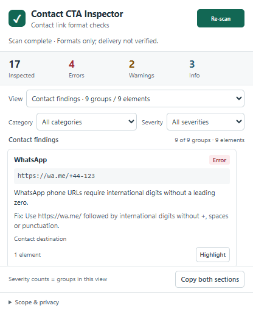

# Contact CTA Inspector

Inspect contact-link formats and contact-labelled controls without confusing ordinary navigation placeholders with contact problems. A small, deterministic, offline Chrome Manifest V3 extension by **Jigar Prajapati**. MIT licensed. Prepared version: **1.1.0**.

## Install

For this local build, extract `release/contact-cta-inspector-1.1.0.zip` to a folder. For a source checkout, first run `npm ci` and `npm run build` to generate that ZIP and `dist`. Build outputs are intentionally not committed. Open `chrome://extensions`, enable Developer mode, choose **Load unpacked**, and select the extracted folder or `dist`. Pin the extension. Open a regular website, open the popup and click **Scan page**. ZIP files cannot be loaded directly. Local HTML files require “Allow access to file URLs” in extension details. Reload the extension after rebuilding. GitHub publication/release assets are not created by local build commands.

## Use

The popup uses a compact 416px document width, a one-line title and a 30px Scan/Re-scan button. After scanning, inspected/error/warning/info counts and filters stay above the main findings scroller. Copy report and Scope & privacy stay below it. At narrow widths filters stack; at 200% zoom the popup can also scroll as a whole to keep every control reachable.

- **Contact findings** is the default view: WhatsApp, telephone and email destinations, plus placeholders or scripted controls with a clear contact signal.
- **General observations** is an opt-in View option for ordinary navigation placeholders, JavaScript links and missing destinations with no clear contact intent. These do not inflate contact severity counts and are not confirmed broken.
- Each View option gives group and affected-element totals. Severity counts show groups across the selected view; category/severity filters affect cards, not these view totals. The findings header gives the filtered groups and affected elements. Identical raw destinations with the same validation result are grouped separately within each view.
- Highlight the first affected element for three seconds. This scrolls it into view; hidden or removed elements cannot be highlighted. Scroll/resize removes the overlay early.
- **Copy both sections** includes separately counted contact findings and general observations, regardless of filters. If clipboard access fails, a selectable redacted report appears.
- **Copy JSON** exports both sections as deterministic, versioned JSON (`schemaVersion: 1`), regardless of filters. Clipboard failure opens a focused, selectable fallback. See [JSON export schema, synthetic example and QA guidance](docs/JSON-EXPORT.md). Review retained contact addresses and paths before sharing.
- Re-scan after the page changes. Closing the popup discards results; element references expire after five minutes or navigation.

## Scope and limitations

Contact intent is an explainable heuristic, not a diagnosis: `mailto:`, `tel:` and recognized WhatsApp hosts are direct signals; bounded English contact labels (including ARIA names, visible nested text, image alt and title fallback) and nearby explicitly labelled contact groups/address elements are weaker signals. Raw label text is used locally and is never returned in findings. Navigation/footer containers do not automatically make their children contact controls. Ambiguous, non-English, icon-only or custom-framework controls can be missed; a contact-labelled control can still be intentional or misclassified. No JavaScript event handlers are inspected or verified. No domain-specific rules, AI classifier or external service is used.

Checks URI structure, not account existence, inbox delivery, phone-number assignment, WhatsApp registration or whether clicking works. No network validation is performed. JavaScript CTAs are marked for manual review, not declared broken. Local/service telephone numbers and recipientless mail composition can be intentional. WhatsApp short-code/business routes require manual review. Unicode email domains and quoted local parts are accepted conservatively; this is not a full RFC mailbox parser. WhatsApp applications and future URL formats are not comprehensively supported.

Only the accessible top-level light DOM is scanned: anchors (including SVG/xlink), areas, elements with link roles, and buttons with explicit href/data-href or a contact-related accessible label/context. Label inspection is bounded to 160 characters, 32 nodes per text traversal, four ARIA references and three ancestors. Form values, editable content, scripts and styles are excluded from label text. Framework handlers are not executed or introspected. Frames (including same-origin and inaccessible frames), shadow roots and links created after the scan are excluded. Hidden anchors can appear in results. Regular HTTP(S) and permitted file pages are supported; internal pages, the Web Store and PDFs are unsupported. Chrome may reject other protected contexts.

Work is limited to 50,000 visited elements, 5,000 candidates, 250 finding groups and 4,096 characters per href. Contact groups receive the report budget first within extracted candidates. Oversized URLs are skipped; limits produce an incomplete-results notice, and displayed counts describe retained findings only. No contact findings means no detected contact problems within these heuristics and boundaries, not a clean bill of health.

## Accessible-name warning (additive)

Direct WhatsApp, `tel:` and `mailto:` controls now receive a separate **WARNING / Accessible name** when bounded inspection confidently finds no name. URL validation remains independent: a valid destination is never called broken by this warning. Before: `<a href="https://wa.me/919876543210"><svg aria-hidden="true"><path /></svg></a>` had no finding. After: one accessible-name warning; adding `aria-label="Message us on WhatsApp"` removes that warning.

This is a missing-name heuristic, not a complete accessibility audit or WCAG compliance assessment. It considers resolved `aria-labelledby` (including explicitly referenced hidden text), `aria-label`, text including visually hidden text, image/area `alt`, SVG `title`, and title fallback. Nonempty ambiguous names are deferred, not judged meaningful. Custom roles/elements, native button label associations, SVG `use`, editable content, chained/cyclic/oversized naming and generated CSS content are conservatively deferred. Hidden controls and controls beyond the three-ancestor visibility boundary may be skipped. It does not verify pronunciation, name quality, accessibility-tree exposure or all native/platform naming behavior.

Warnings group unnamed occurrences by identical raw destination, separately from URL findings. A named duplicate does not suppress an unnamed duplicate. Highlight targets the first unnamed occurrence. Counts retain existing semantics: occurrences are summed per finding group, so one control with both a URL error and a name warning contributes to both groups. Contact URL findings receive the 250-group budget before name warnings, followed by general observations; IDs and ordering are deterministic. Existing DOM/candidate/URL limits remain; name traversal adds at most 32 elements, 16 children per element, 160 characters per source, four ARIA references and three visibility ancestors. No label text or form values leave the page.

## Privacy and permissions

`activeTab` grants temporary access after invocation; `scripting` performs the user-requested scan and highlight. There are no host permissions, background worker, storage, accounts, analytics or runtime network calls. No forms, event-handler code or page text are returned. URL queries/fragments, script payloads and URL credentials are hidden before findings leave the page. Contact addresses, telephone numbers and path contents can remain in reports: review before sharing. No browsing history or results are persisted. The clipboard changes only on explicit Copy.

## Develop

Node 22.12+ or Node 24 and npm are required.

```sh
npm ci
npm run check
npm audit --audit-level=moderate
```

`npm run dev` serves a UI development preview; Chrome APIs require the built extension. `npm run build` produces `dist` and the ZIP. `public/demo.html` is a synthetic fixture: serve the repository over localhost and open it there. It is excluded from release packaging. `npm test` runs synthetic DOM, integration, rules and popup tests. CI defines Node 22/24 on Ubuntu, Windows and macOS; configured jobs are not evidence that those remote checks have run.

Architecture: `extract.ts` bounds DOM work; `intent.ts` determines contact intent; `rules.ts` validates formats without changing severity based on intent; `scan.ts` prioritizes/groups findings and associates elements; `privacy.ts` redacts; `content.ts` is bundled as an isolated injection; `bridge.ts` contains Chrome calls; `highlight.ts` manages temporary overlays; `report.ts` handles scoped counts/filters and sectioned report text; `json-report.ts` builds bounded, allowlisted structured exports; `popup.ts` renders with text nodes. Only static application markup uses innerHTML.

## Screenshots



[General observations view](docs/screenshots/popup-native-general.png) · [Navigation-only acceptance scenario](docs/screenshots/popup-navigation-noise.png)

Actual automated Chrome captures are in `docs/screenshots`: `popup-native-initial.png` and `popup-native-results.png` show the native action popup; `popup-empty.png`, `popup-results.png`, `popup-error.png` and `popup-no-findings.png` show the extension document states; `popup-narrow.png` tests 320px and long URLs; `popup-zoom-200.png` tests real Chrome 200% tab zoom. Store screenshots still need store-appropriate sizing. To reproduce: build and run `npm run smoke` with installed Chrome (`CHROME_PATH` can override the executable path). Use synthetic pages only. See `docs/VERIFICATION.md` for measurements and remaining release checks.

## Hire Me

Built and maintained by **Jigar Prajapati**. Available for browser extensions, practical developer tools and privacy-conscious web engineering. Discuss a project through [GitHub](https://github.com/jigar48) or [LinkedIn](https://www.linkedin.com/in/buildaiwith-jigar-prajapati/).

### Support This Project

If this independent open-source project is useful to you, you can support its ongoing maintenance.

[](https://buymeacoffee.com/buildwithjigar)

Support is optional; issue reports and feedback are also welcome.
